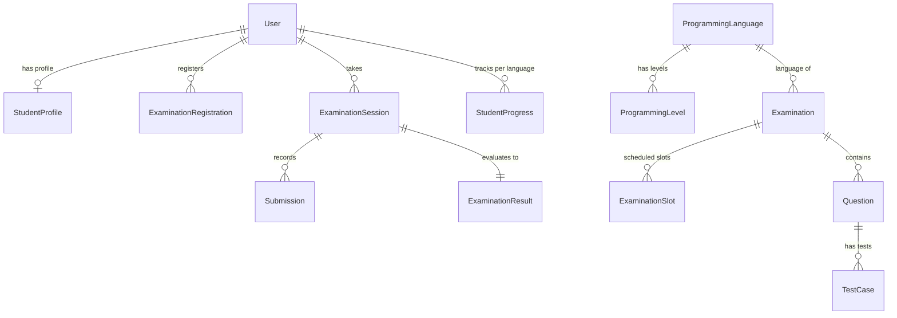

# Database Design & Schemas: College Programming Assessment Portal

The database utilizes MongoDB with Mongoose ODM, enforcing strict schemas, indexes, and document integrity.

## Schema Reference

### 1. `User`
- `_id`: ObjectId
- `email`: String (Unique, Lowercase, Indexed)
- `passwordHash`: String (Bcrypt salted hash)
- `role`: Enum (`student`, `faculty`, `controller`, `admin`)
- `firstName`: String
- `lastName`: String
- `studentId`: String (Sparse Unique Index)
- `isActive`: Boolean (Default: true)
- `collegeIpExempt`: Boolean (Default: false)

### 2. `StudentProfile`
- `userId`: ObjectId -> `User` (Unique)
- `studentId`: String (Unique)
- `department`: String
- `batch`: String
- `semester`: Number
- `enrollmentNumber`: String (Unique)

### 3. `ProgrammingLanguage`
- `name`: String (Unique)
- `slug`: String (Unique, Indexed)
- `executionEngineId`: String (`c`, `cpp`, `java`, `python`, `javascript`)
- `totalLevels`: Number (6 for C, C++, Java, Python; 4 for others)
- `isEnabled`: Boolean
- `defaultTimeLimitMs`: Number
- `defaultMemoryLimitMb`: Number
- `templateCode`: String

### 4. `ProgrammingLevel`
- `languageId`: ObjectId -> `ProgrammingLanguage`
- `levelNumber`: Number (1 to 6)
- `title`: String
- `defaultPassingPercentage`: Number (Default: 60)
- `prerequisiteLevel`: Number (Level 1 is null; Level N requires N-1)
- *Compound Unique Index*: `(languageId, levelNumber)`

### 5. `Question`
- `title`: String
- `slug`: String (Unique)
- `description`: String
- `inputFormat`: String
- `outputFormat`: String
- `constraints`: String
- `examples`: Array of `{ input, output, explanation }`
- `allowedLanguages`: Array of strings
- `targetLevel`: Number
- `difficulty`: Enum (`Easy`, `Medium`, `Hard`)
- `marks`: Number (Default: 100)
- `createdBy`: ObjectId -> `User`

### 6. `TestCase`
- `questionId`: ObjectId -> `Question` (Indexed)
- `input`: String
- `expectedOutput`: String
- `isHidden`: Boolean (Public tests false; Hidden benchmark tests true)
- `weight`: Number
- `order`: Number

### 7. `Examination`
- `title`: String
- `description`: String
- `languageId`: ObjectId -> `ProgrammingLanguage`
- `levelNumber`: Number
- `registrationStartDate`: Date
- `registrationEndDate`: Date
- `examDate`: Date
- `durationMinutes`: Number
- `maxStudents`: Number
- `passingPercentage`: Number
- `questions`: Array of ObjectIds -> `Question`
- `isPublished`: Boolean
- `sebRequired`: Boolean
- `collegeNetworkOnly`: Boolean

### 8. `ExaminationSlot`
- `examinationId`: ObjectId -> `Examination` (Indexed)
- `slotName`: String
- `startTime`: Date
- `endTime`: Date
- `capacity`: Number
- `registeredCount`: Number (Tracked via atomic operations)

### 9. `ExaminationRegistration`
- `examinationId`: ObjectId -> `Examination`
- `slotId`: ObjectId -> `ExaminationSlot`
- `studentId`: ObjectId -> `User`
- `status`: Enum (`registered`, `cancelled`, `attended`, `absent`)
- *Compound Unique Index*: `(examinationId, studentId)` (Prevents duplicate bookings)

### 10. `ExaminationSession`
- `examinationId`: ObjectId -> `Examination`
- `slotId`: ObjectId -> `ExaminationSlot`
- `studentId`: ObjectId -> `User`
- `startedAt`: Date
- `deadline`: Date (Authoritative deadline calculated on server)
- `status`: Enum (`active`, `submitted`, `expired`, `terminated`)
- `drafts`: Map of `{ questionId: { code, language, updatedAt } }`

### 11. `Submission`
- `sessionId`: ObjectId -> `ExaminationSession`
- `examinationId`: ObjectId -> `Examination`
- `studentId`: ObjectId -> `User`
- `questionId`: ObjectId -> `Question`
- `language`: String
- `code`: String
- `verdict`: Enum (`Accepted`, `Wrong Answer`, `Compilation Error`, `Runtime Error`, `Time Limit Exceeded`, `Memory Limit Exceeded`)
- `score`: Number
- `maxScore`: Number
- `testCaseResults`: Array of `{ testCaseId, passed, actualOutput, isHidden, executionTimeMs }`

### 12. `ExaminationResult`
- `sessionId`: ObjectId -> `ExaminationSession` (Unique)
- `examinationId`: ObjectId -> `Examination`
- `studentId`: ObjectId -> `User`
- `languageId`: ObjectId -> `ProgrammingLanguage`
- `levelNumber`: Number
- `totalMarks`: Number
- `obtainedMarks`: Number
- `percentage`: Number
- `passed`: Boolean (True if percentage >= exam.passingPercentage)
- `verifiedAt`: Date

### 13. `StudentProgress`
- `studentId`: ObjectId -> `User`
- `languageId`: ObjectId -> `ProgrammingLanguage`
- `highestUnlockedLevel`: Number (Defaults to 1, no prerequisite for Level 1)
- `completedLevels`: Array of `{ levelNumber, passedAt, percentage, examinationId, resultId }`
- *Compound Unique Index*: `(studentId, languageId)`

### 14. `AuditLog`
- `userId`: ObjectId -> `User`
- `action`: String
- `details`: Mixed
- `ipAddress`: String
- `timestamp`: Date

